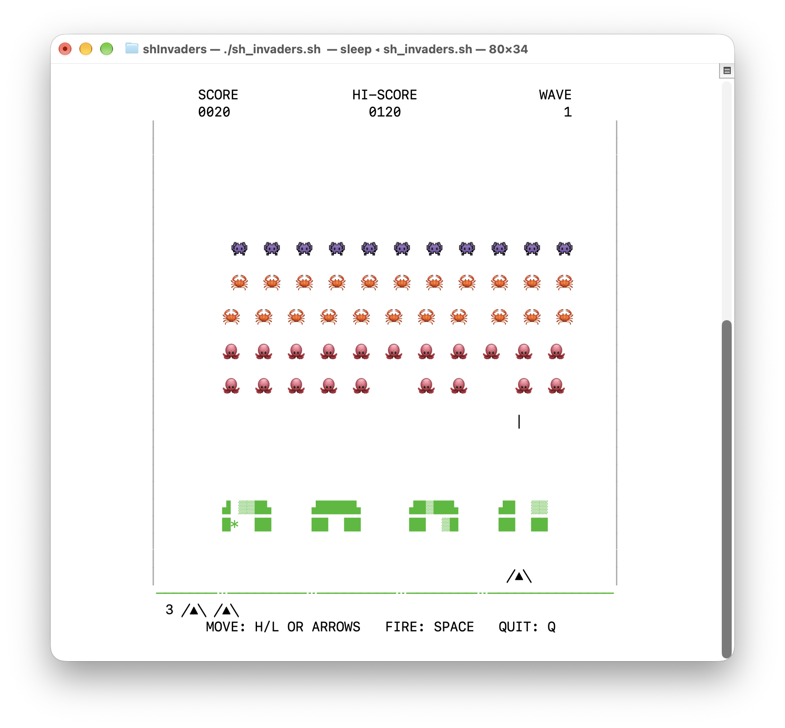

# #!/bin/sh Invaders

**Space Invaders** in a terminal, written in **unnecessarily pure old-school
POSIX shell**. As faithful to the 1978 arcade game as a grid of characters
allows.

## Launching

`sh sh_invaders.sh` - or just `./sh_invaders.sh` if you’ve gone wild and
marked it as executable.

To make it output pure ASCII, without any of that modern nonsense like
emoji or Unicode symbols, add `-a` (or press `T` while playing).

Tested in `sh`, `dash`, `bash` (including the bash 3.2 that comes with
macOS) and Korn shells (including OpenBSD’s `sh`). In `zsh`, use
`zsh --emulate sh sh_invaders.sh`.

## Playing

| Key                         | Action                                 |
|-----------------------------|----------------------------------------|
| `←` `→`, `H` `L` or `A` `D` | Move                                   |
| Space or `↑`                | Fire                                   |
| `R`                         | Start (and play again after game over) |
| `Q`                         | Quit                                   |
| `F`                         | Show or hide the frame rate (top left) |
| `T`                         | Switch between emoji and plain ASCII   |

The high score is kept in `~/.sh_invaders_hiscore`.

## Terminal

- **Size:** At least **58 × 24** to play. For “arcade-accurate” play, use
  at least **58 × 32**.

  The playfield is always 56 columns wide, and as tall as the terminal up
  to 32 rows.

  *But!* Only at 32 rows does each row match 8 of the arcade’s pixels - the
  distance the invaders drop each time they reach an edge. Because we can’t
  drop less than a character space, on shorter terminals, each drop covers
  more logical ground, so the invaders reach the shields and the cannon
  sooner, and the game is harder.

  macOS Terminal’s default window is 80 × 24 for macOS’s grayer users, and
  120 × 30 for the younguns. So make it a little taller unless you’re an
  Invaders savant.

  You can resize the window while playing.

  A VT-101 was 80 × 24 back in the day – so using one of them is Hard Mode.
  [Let me know](mailto:jamie@montgomerie.net) if you’ve tried it!

- **Characters:** You’ll want a UTF-8 locale and a monospaced font with
  emoji that are double-character-width. (macOS’s Terminal.app works great
  by default!)

  If layout looks bad (or you just want an old-school feel!) launch with
  `-a` (“ASCII”) or press `T` while playing to toggle ASCII mode.

## POSIX, huh?

Aside from a POSIX-compliant `/bin/sh`, this script also needs `stty`,
`sleep` and `date`.

These commands are used as POSIX defines them, with (sadly) *one
exception*: it *needs* `sleep` to accept fractions of a second
(`sleep 0.016`); POSIX just requires that sleep takes integer
seconds[^sleep_ideas]. macOS, all Linux distros I know of, and the BSDs
all do.

[^sleep_ideas]: If you or your super intelligent agent have ideas to get
    around this and be POSIX-pure,
    [let me know](mailto:jamie@montgomerie.net) - or open a pull request!

`sleep` and `date` are used to time the gameplay, to keep the game at 60
‘frames’ a second (the screen doesn’t actually update the terminal this
fast, but the logic, based on the arcade ROM, updates at this speed).

Some systems (for example, OpenBSD (usually)) sleep in steps of a
hundredth of a second – too coarse for 60 fps. On systems like this, the
game busy-waits between frames instead, which keeps a processor busy. On a
fast enough machine it also sleeps every third frame, locked to those
steps, for a little bit of CPU saving.

The screen isn’t cleared between frames, so it doesn’t flicker even in
terminals without synchronized output[^terminal] and the game’s
[baud rate](https://en.wikipedia.org/wiki/Baud) is low - a typical frame is
about 100 bytes.

[^terminal]: (Side-eyes to `Terminal.app`...)

## Arcade accurate?

The rules and timings come from the arcade’s code, via the commented
disassembly at [computerarcheology.com][code].

The game runs at the arcade’s 60 frames a second, and where it can it works
in the arcade’s own coordinates (its 224 × 256-pixel screen). Shots, for
example, move in the arcade’s pixels. One column is 4 arcade pixels.

As in the arcade:

- The invaders move one at a time, rippling through the formation from the
  bottom left, and turn where the arcade’s do. They speed up as their
  numbers fall.
- Later waves start lower, at the arcade’s heights.
- The three kinds of invader shot (rolling, plunger and squiggly) move, aim
  and reload as the arcade’s do, and fire from the same table of columns.
  Their characters animate like the arcade’s pictures, as far as Unicode
  allows, and they speed up when 8 or fewer invaders are left.
- Shots meeting each other can pass, or either or both can be destroyed,
  with the frequencies the arcade’s pixel collisions give. TL;DR: you’ll read
  around the web that “When an invader’s missile collides with a player’s
  laser shot, the player’s shot is always destroyed but the invader’s
  missile occasionally survives, almost certainly if it is a wiggly missile”
  ([ClassicGaming.cc][cgc]; [BrentRadio][brent] have the same text) – but the
  ROM disassembly doesn’t seem to bear this out. See
  [docs/shot-collisions](docs/shot-collisions/README.md) for Claude’s
  analysis.
- The shields wear away, and invaders passing through them erase them.
- Invader shots landing wear away the green “ground” line at the bottom. This
  is just cosmetic.
- The flying saucer appears every 1536 frames once the invaders are low
  enough – and its score depends on how many shots you’ve fired.
- An extra cannon is awarded at 1500 points.
- Explosions last as long as the arcade’s, and as in the arcade you can’t
  fire until the explosion has ended.

### The main differences

- Invaders are emoji (or pairs of ASCII characters), so they don’t
  switch between two pictures as they move.
- Positions are only as fine as a terminal cell. Where the arcade’s
  outcome depends on pixels the game doesn’t have (shots meeting, which
  parts of the ground erode), it’s chosen with the arcade’s frequencies.
- One player only, and no sound apart from the terminal bell when you’re
  hit or win a cannon.

#!/bin/sh Invaders was mostly written by Claude, although with a *surprising
number* of clarifications, redirections, pushes for accuracy and aesthetic
decisions by me, [Jamie Montgomerie](https://www.blog.montgomerie.net).

[code]: https://computerarcheology.com/Arcade/SpaceInvaders/Code.html
[cgc]: https://classicgaming.cc/classics/space-invaders/play-guide
[brent]: https://www.brentradio.com/SpaceInvaders2.htm
